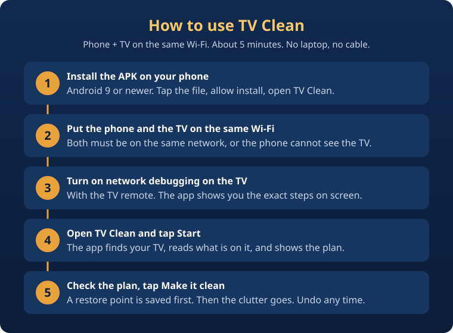

# TV Clean

**One APK on your phone controls the TV and finishes the whole clean-up. No laptop. No cable. No coding.**

TV Clean is an Android phone app by [PromptStudio](https://promptstudioai.in). Open it, tap Start, and the ads and bloat are gone from your Android TV in about five minutes. Three steps: connect, analyse, clean.

## What's new in TV Clean (vs the base)

TV Clean is built on the open-source [Clean Your TV app](https://github.com/udhaykumarbala/cleanyourtv-app) (MIT) and the [Clean Your TV](https://github.com/Gathin23/cleanyourtv) project by Gathin. Our version adds:

1. **TLS pairing — no computer needed.** The base speaks plain ADB on port 5555 only. TVs that only offer wireless debugging with a pairing code needed one computer pairing first. TV Clean pairs over TLS from the phone alone, so those TVs work with no computer at all. (Implemented and unit-tested; not yet tried against a real TV — the first real pairing is the true test.)
2. **Indian TV profiles first.** Added careful brand lists for the Android TVs people actually have in India — Vu, Realme, Acer, Nokia, Infinix, Kodak, iFFALCON, CloudWalker, Blaupunkt — alongside the existing Xiaomi, TCL, Sony, OnePlus, Hisense and Philips lists. Indian brands are shown first in the picker.
3. **Tamil + English UI.** The main flow (Connect, Analyse, Clean and the key status messages) is available in Tamil as well as English.
4. **Our own launcher (in progress).** The home screen will be TV Clean's own leanback launcher (`ai.promptstudio.tvclean.launcher`, module `tv/launcher` in this repo) — not Gathin's. The launcher code is written, but the APK the app installs today is still Gathin's bundled one: the new launcher has to be built, signed with a new TV Clean release key, and its signer pinned before it replaces the bundled APK.

## How to use it



1. **Install the APK on your phone** — Android 9 or newer. Download `app-full-debug.apk` from the [latest debug build](https://github.com/shanmugaraj711-dotcom/tv-clean/releases/tag/debug), tap the file, allow the install, open TV Clean.
2. **Put the phone and the TV on the same Wi-Fi** — both must be on the same network, or the phone cannot see the TV.
3. **Turn on network debugging on the TV** — with the TV remote. The app shows you the exact steps on screen. If your TV only offers wireless debugging with a pairing code, the app pairs over TLS from the phone alone, no computer needed.
4. **Open TV Clean and tap Start** — the app finds your TV, reads what is on it, and shows the plan: what goes off and what stays. Nothing changes yet.
5. **Check the plan, tap Make it clean** — a restore point is saved first, then the clutter goes and the new home screen comes on. About five minutes. You can put anything back from the restore point.

*Real phone screenshots of each step will replace the diagram above after the first TV test.*

## How it works

| 1. Connect | 2. Analyse | 3. Clean |
| --- | --- | --- |
| The app finds your TV on the Wi-Fi and shows you how to let the phone in with the remote. | It reads what is on the TV and shows the plan: what goes off and what stays. Nothing changes yet. | Tap "Make it clean". A restore point first, then the clutter goes and the new home screen comes on. |

**You need** an Android phone (Android 9 or newer, with a screen lock) on the same Wi-Fi as the TV. Connecting takes about a minute (you switch on network debugging with the remote; the app shows you how), and the whole clean-up about five minutes.

Come back any time to put an app back, check for leftovers after a TV update, change the dock or the look, or undo everything.

## What your TV gets

Not every TV gets the new home screen yet. The app says which of these your TV gets before it changes anything, on the "What we found" screen, and why.

|  | Which TVs | What the app does |
| --- | --- | --- |
| **New home screen and clean-up** | TVs where testers confirmed the switch holds after a restart | Switches off the clutter and puts the TV Clean home screen in charge, with a restore point first |
| **Clean-up only, for now** | Most Google TV sets, TVs the app has not met before | Switches off adverts, tracking and background apps. The TV keeps its own home screen |
| **Not possible** | Fire TV, TCL's China builds, Android 7 and older | Clean-up only, and the app says so up front |

## Safe by design

- **You see every step.** Nothing runs until you have seen the plan, and Customise shows every command the app would send, in order.
- **Nothing is deleted.** Apps are switched off for the main user, so each one can come back. Wi-Fi, the Play Store, the remote, the TV's inputs and the parts Android needs are protected and never touched.
- **Undo anything.** Put back one app or everything from the restore point. "Save a copy" exports plain restore scripts that work from any computer with adb, even without this app.
- **A watchdog on the TV.** If the phone does not confirm the new home screen within 150 seconds (the Wi-Fi drops, the phone dies), the TV puts its own home screen back by itself.
- **Private.** No accounts, no analytics, no ads. The app talks to your TV and, only when you ask, to GitHub for updates. Network debugging is switched off again at the end unless you keep it on.

## Supported TVs

TV lists from the Clean Your TV community, plus the Indian-brand profiles added in TV Clean: Xiaomi, TCL, Sony, OnePlus, Hisense, Philips, Panasonic, Haier, Motorola, Thomson, Vu, Realme, Acer, Nokia, Infinix, Kodak, iFFALCON, CloudWalker and Blaupunkt, on Android TV, Google TV and Fire OS.

**Your TV is not listed?** Add its report from the app ("Help add this TV") and it moves up in a later release.

## For developers

```
git clone https://github.com/shanmugaraj711-dotcom/tvclean.git
cd tvclean
./gradlew check assembleDebug        # JDK 21 and the Android SDK
```

A Kotlin and Jetpack Compose app that speaks ADB to the TV itself, with no computer in between. See `CONTRIBUTING.md` for tests and module rules.

## Credits

- Based on the [Clean Your TV app](https://github.com/udhaykumarbala/cleanyourtv-app) by udhaykumarbala and its contributors (MIT), itself built on [Clean Your TV](https://github.com/Gathin23/cleanyourtv) by Gathin and its community contributors, whose clean-up lists and test reports this app is built on.
- The ADB protocol code started from [dadb](https://github.com/mobile-dev-inc/dadb) by mobile.dev (Apache 2.0, see `adb/wire/NOTICE`).
- The [Outfit](https://fonts.google.com/specimen/Outfit) typeface (SIL Open Font License 1.1).
- Full list: `THIRD-PARTY-NOTICES`. Licence: [MIT](LICENSE), like the base.
